# Entity Relationship Diagram (ERD)
## WorkPulse SaaS Database Architecture

```mermaid
erDiagram
    users ||--o{ user_sessions : has
    users ||--o{ business_memberships : joins
    users ||--o{ user_roles : assigned
    users ||--o{ employees : identified_as
    users ||--o{ audit_logs : triggers
    users ||--o{ notifications : receives

    businesses ||--|{ business_memberships : has
    businesses ||--o{ branches : operates
    businesses ||--o{ departments : contains
    businesses ||--o{ designations : defines
    businesses ||--o{ employees : employs
    businesses ||--o{ shifts : configures
    businesses ||--o{ leave_types : provides
    businesses ||--o{ salary_components : configures
    businesses ||--o{ payroll_runs : executes
    businesses ||--o{ expense_categories : tracks
    businesses ||--o{ cash_transactions : records
    businesses ||--o| subscriptions : holds

    roles ||--o{ role_permissions : includes
    permissions ||--o{ role_permissions : granted_to
    roles ||--o{ user_roles : assigned_in

    branches ||--o{ employees : stations
    branches ||--o{ holidays : observes
    departments ||--o{ employees : groups
    designations ||--o{ employees : classifies

    employees ||--o{ attendance_records : logs
    employees ||--o{ shift_assignments : works
    employees ||--o{ leave_requests : submits
    employees ||--o{ leave_balances : maintains
    employees ||--o{ employee_salary_structures : holds
    employees ||--o{ payroll_items : receives_in_run
    employees ||--o{ advances : requests
    employees ||--o{ loans : receives_loan
    employees ||--o{ reimbursements : claims
    employees ||--o{ employee_documents : uploads
    employees ||--o{ employment_history : logs_changes

    attendance_records ||--o{ attendance_punches : records
    attendance_records ||--o{ attendance_corrections : requests_correction
    shifts ||--o{ attendance_records : schedules
    shifts ||--o{ shift_assignments : assigned_to

    leave_types ||--o{ leave_requests : categorizes
    leave_types ||--o{ leave_balances : tallies

    payroll_runs ||--|{ payroll_items : calculates
    payroll_items ||--o{ payroll_item_components : details
    payroll_items ||--o| payslips : issues
    payroll_items ||--o{ salary_payments : disburses

    loans ||--o{ loan_repayments : amortizes
    expense_categories ||--o{ expenses : categorizes
    expense_categories ||--o{ cash_transactions : groups

    subscription_plans ||--o{ subscriptions : subscribes
    subscriptions ||--o{ invoices : bills
    invoices ||--o{ payment_transactions : paid_by
```

### Key Cardinalities & Constraints
1. **Tenant Boundary:** Every table with `business_id` is strictly isolated per tenant. No cross-tenant joins permitted.
2. **Attendance Lock:** `attendance_records` have a unique constraint on `(employee_id, date)`.
3. **Leave Ledger:** `leave_balances` are strictly unique per `(employee_id, leave_type_id, year)`.
4. **Payroll Item:** `payroll_items` are unique per `(payroll_run_id, employee_id)` and lock calculation historical state.

