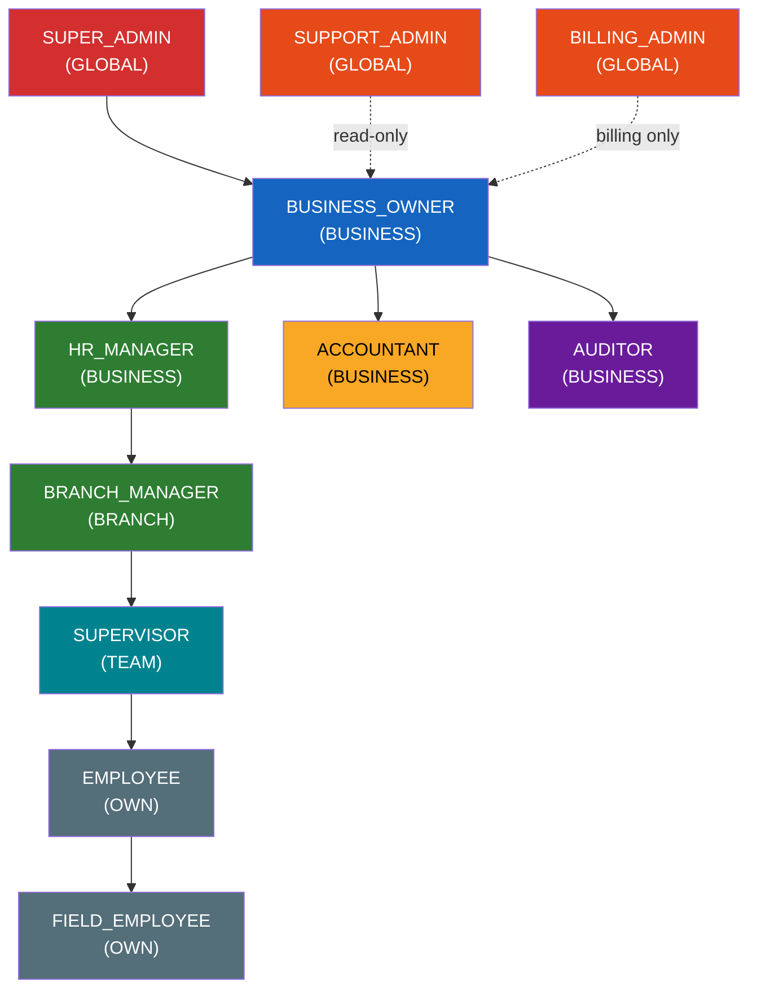
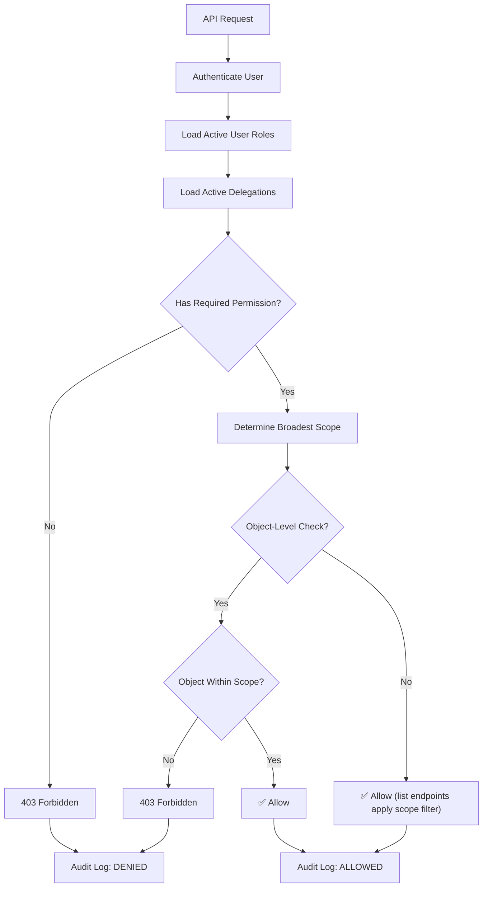

# WorkPulse RBAC Permission Matrix

> **Version:** 1.0.0
> **Last Updated:** 2026-11-10
> **Status:** Authoritative Reference
> **Owner:** Platform Engineering Team

---

## Table of Contents

1. [Overview](#1-overview)
2. [Role Definitions](#2-role-definitions)
3. [Resource Scopes](#3-resource-scopes)
4. [Permission Code Registry](#4-permission-code-registry)
5. [Permission Matrix](#5-permission-matrix)
   - [Employee Permissions](#51-employee-permissions)
   - [Attendance Permissions](#52-attendance-permissions)
   - [Shift Permissions](#53-shift-permissions)
   - [Leave Permissions](#54-leave-permissions)
   - [Payroll Permissions](#55-payroll-permissions)
   - [Salary Permissions](#56-salary-permissions)
   - [Advance Permissions](#57-advance-permissions)
   - [Loan Permissions](#58-loan-permissions)
   - [Expense Permissions](#59-expense-permissions)
   - [Report Permissions](#510-report-permissions)
   - [Business Permissions](#511-business-permissions)
   - [Role Permissions](#512-role-permissions)
   - [Notification Permissions](#513-notification-permissions)
   - [Subscription Permissions](#514-subscription-permissions)
   - [Audit Permissions](#515-audit-permissions)
   - [Platform Permissions](#516-platform-permissions)
6. [Permission Inheritance Rules](#6-permission-inheritance-rules)
7. [Custom Role Creation Rules](#7-custom-role-creation-rules)
8. [Delegation Constraints](#8-delegation-constraints)
9. [Permission Conflict Resolution](#9-permission-conflict-resolution)
10. [Default Role Assignments](#10-default-role-assignments)
11. [Implementation Reference](#11-implementation-reference)

---

## 1. Overview

WorkPulse implements a **Scope-Aware Role-Based Access Control (RBAC)** system that governs access to every API endpoint, UI element, and data resource across the platform. The model combines predefined roles, granular permission codes, and hierarchical resource scopes to enforce the principle of least privilege at every layer.

### Design Principles

| Principle | Description |
|---|---|
| **Least Privilege** | Every role receives only the minimum permissions required to perform its function. |
| **Scope Containment** | Permissions are always bounded by a resource scope—no role can operate outside its assigned scope. |
| **Explicit Deny** | Access is denied by default; only explicitly granted permissions are honored. |
| **Non-Escalation** | No user can grant, delegate, or create permissions that exceed their own effective permission set. |
| **Auditability** | Every permission check, grant, revocation, and delegation is logged to the audit trail. |

### Architecture Summary

```
┌─────────────────────────────────────────────────────────┐
│                    HTTP Request                         │
├─────────────────────────────────────────────────────────┤
│  1. Authentication (JWT / Session)                      │
│  2. Role Resolution (User → Roles → Permissions)        │
│  3. Scope Resolution (Role Scope + Object Ownership)    │
│  4. Permission Check (permission_code + scope)          │
│  5. Row-Level Filtering (QuerySet scoping)              │
│  6. Audit Log Entry                                     │
└─────────────────────────────────────────────────────────┘
```

> [!IMPORTANT]
> Every permission grant in the matrix below includes a **scope qualifier**. A permission without a scope is meaningless—`employee.view` with scope `BRANCH` means the user can view employees **only** within their assigned branches.

---

## 2. Role Definitions

### 2.1 Platform-Level Roles

Platform-level roles operate across business boundaries and are reserved for WorkPulse internal operations staff.

| Role | Code | Scope | Description |
|---|---|---|---|
| **Super Admin** | `SUPER_ADMIN` | `GLOBAL` | Unrestricted platform access. Manages all businesses, subscriptions, feature flags, and platform health. Reserved for WorkPulse engineering and operations leads. |
| **Support Admin** | `SUPPORT_ADMIN` | `GLOBAL` | Read access to business data for troubleshooting. Can manage support tickets, impersonate users (read-only), and escalate issues. Cannot modify business configurations or financial data. |
| **Billing Admin** | `BILLING_ADMIN` | `GLOBAL` | Manages subscription plans, billing cycles, invoices, and payment methods across all businesses. No access to business operational data (employees, attendance, etc.). |

### 2.2 Business-Level Roles

Business-level roles are scoped to a single business tenant. A user may hold different business-level roles across multiple businesses.

| Role | Code | Scope | Description |
|---|---|---|---|
| **Business Owner** | `BUSINESS_OWNER` | `BUSINESS` | Full administrative control within their business. Manages settings, branches, departments, roles, and all operational data. First user of every new business account. |
| **HR Manager** | `HR_MANAGER` | `BUSINESS` | Manages the employee lifecycle—onboarding, profile updates, document management, attendance policies, leave configuration, and payroll processing. Business-wide scope. |
| **Branch Manager** | `BRANCH_MANAGER` | `BRANCH` | Manages operations within assigned branches. Can view and manage employees, attendance, shifts, and leaves for their branch(es). Cannot access other branches or business-wide settings. |
| **Accountant** | `ACCOUNTANT` | `BUSINESS` | Handles financial operations—payroll calculation, salary disbursement, advance/loan processing, and expense management. Read access to employee data as needed for financial workflows. |
| **Supervisor** | `SUPERVISOR` | `TEAM` | Manages a team of direct reports. Can mark attendance, approve leaves, and view reports for their team. Cannot modify employee profiles or access payroll. |
| **Employee** | `EMPLOYEE` | `OWN` | Self-service access to own profile, attendance records, leave applications, pay slips, and expense submissions. |
| **Field Employee** | `FIELD_EMPLOYEE` | `OWN` | All Employee permissions plus field-specific capabilities: GPS-based attendance, field visit logging, and on-site expense reporting. |
| **Auditor** | `AUDITOR` | `BUSINESS` | Read-only access across the business for compliance and audit purposes. Can view all operational and financial data but cannot create, modify, or delete any resource. |

### 2.3 Role Hierarchy



> [!NOTE]
> Solid arrows indicate permission inheritance (higher role inherits all permissions of the lower role). Dashed arrows indicate partial/scoped inheritance. The hierarchy is used for conflict resolution but **not** for automatic permission propagation—each role's permissions are explicitly defined.

---

## 3. Resource Scopes

Scopes define the **boundary** of data a permission applies to. Every permission grant is paired with exactly one scope.

| Scope | Code | Boundary | Example |
|---|---|---|---|
| **Global** | `GLOBAL` | All resources across all businesses on the platform | Super Admin viewing all businesses |
| **Business** | `BUSINESS` | All resources within a single business tenant | HR Manager viewing all employees in their company |
| **Branch** | `BRANCH` | Resources within one or more assigned branches | Branch Manager viewing employees in "Downtown Office" |
| **Department** | `DEPARTMENT` | Resources within one or more assigned departments | Department head viewing their department's attendance |
| **Team** | `TEAM` | Resources belonging to directly assigned team members | Supervisor viewing their 8 direct reports |
| **Own** | `OWN` | Only resources owned by or directly related to the requesting user | Employee viewing their own pay slip |

### Scope Hierarchy

```
GLOBAL ⊃ BUSINESS ⊃ BRANCH ⊃ DEPARTMENT ⊃ TEAM ⊃ OWN
```

A higher scope **contains** all lower scopes. A user with `BUSINESS` scope on `employee.view` can view all employees in the business, which inherently includes all branches, departments, and teams.

### Scope Assignment

| Role Level | Assigned Scope | Scope Binding |
|---|---|---|
| Platform roles | `GLOBAL` | Bound to the WorkPulse platform |
| `BUSINESS_OWNER` | `BUSINESS` | Bound to `business_id` at registration |
| `HR_MANAGER` | `BUSINESS` | Bound to `business_id` at role assignment |
| `BRANCH_MANAGER` | `BRANCH` | Bound to one or more `branch_id` values |
| `ACCOUNTANT` | `BUSINESS` | Bound to `business_id` at role assignment |
| `SUPERVISOR` | `TEAM` | Bound to a list of `employee_id` values (direct reports) |
| `EMPLOYEE` | `OWN` | Bound to own `employee_id` |
| `FIELD_EMPLOYEE` | `OWN` | Bound to own `employee_id` |
| `AUDITOR` | `BUSINESS` | Bound to `business_id` at role assignment |

---

## 4. Permission Code Registry

All permission codes follow the pattern `<resource>.<action>`. Each code is unique and maps to one or more API endpoints.

### 4.1 Complete Permission Code List

| Category | Code | Description | HTTP Methods |
|---|---|---|---|
| **Employee** | `employee.view` | View employee profiles and details | GET |
| | `employee.create` | Create new employee records | POST |
| | `employee.update` | Update employee profile information | PUT, PATCH |
| | `employee.deactivate` | Deactivate/terminate employee accounts | PATCH |
| | `employee.bulk_import` | Bulk import employees via CSV/Excel | POST |
| | `employee.export` | Export employee data to CSV/Excel | GET |
| | `employee.transfer` | Transfer employees between branches/departments | POST |
| | `employee.view_documents` | View employee uploaded documents | GET |
| | `employee.manage_documents` | Upload, update, or delete employee documents | POST, PUT, DELETE |
| **Attendance** | `attendance.view` | View attendance records | GET |
| | `attendance.mark` | Mark attendance for other employees | POST |
| | `attendance.mark_own` | Mark own attendance (clock in/out) | POST |
| | `attendance.correct` | Correct/override attendance entries | PUT, PATCH |
| | `attendance.approve` | Approve corrected or disputed attendance | PATCH |
| | `attendance.lock` | Lock attendance for a pay period | POST |
| | `attendance.view_reports` | View attendance summary reports | GET |
| | `attendance.export` | Export attendance data | GET |
| **Shifts** | `shift.view` | View shift definitions and assignments | GET |
| | `shift.create` | Create new shift definitions | POST |
| | `shift.update` | Update existing shift parameters | PUT, PATCH |
| | `shift.delete` | Delete shift definitions | DELETE |
| | `shift.assign` | Assign employees to shifts | POST, PUT |
| | `shift.view_roster` | View shift rosters and schedules | GET |
| **Leaves** | `leave.view` | View leave records and balances | GET |
| | `leave.apply` | Apply for leave (own or on behalf) | POST |
| | `leave.approve` | Approve leave applications | PATCH |
| | `leave.reject` | Reject leave applications | PATCH |
| | `leave.cancel` | Cancel approved/pending leave | PATCH |
| | `leave.configure` | Configure leave types, policies, accruals | POST, PUT, DELETE |
| | `leave.view_reports` | View leave summary reports | GET |
| **Payroll** | `payroll.view` | View payroll runs and details | GET |
| | `payroll.calculate` | Trigger payroll calculation | POST |
| | `payroll.review` | Review calculated payroll before approval | GET, PATCH |
| | `payroll.approve` | Approve payroll for disbursement | PATCH |
| | `payroll.lock` | Lock payroll period (prevent changes) | POST |
| | `payroll.view_own` | View own payroll/pay slips | GET |
| | `payroll.export` | Export payroll data | GET |
| | `payroll.adjust` | Make manual payroll adjustments | POST, PATCH |
| **Salary** | `salary.view` | View salary structures and details | GET |
| | `salary.create` | Create salary structure for employees | POST |
| | `salary.update` | Update salary components and amounts | PUT, PATCH |
| | `salary.disburse` | Initiate salary disbursement/bank transfer | POST |
| | `salary.view_own` | View own salary details and history | GET |
| **Advances** | `advance.view` | View advance requests and records | GET |
| | `advance.request` | Submit advance salary requests | POST |
| | `advance.approve` | Approve advance requests | PATCH |
| | `advance.disburse` | Disburse approved advances | POST |
| | `advance.view_own` | View own advance requests | GET |
| **Loans** | `loan.view` | View loan records and repayment schedules | GET |
| | `loan.create` | Create employee loan records | POST |
| | `loan.approve` | Approve loan applications | PATCH |
| | `loan.disburse` | Disburse approved loans | POST |
| | `loan.view_own` | View own loan details | GET |
| **Expenses** | `expense.view` | View expense claims and records | GET |
| | `expense.create` | Submit expense claims | POST |
| | `expense.approve` | Approve expense claims | PATCH |
| | `expense.export` | Export expense data | GET |
| | `expense.view_own` | View own expense claims | GET |
| **Reports** | `report.view` | View business-wide reports and dashboards | GET |
| | `report.export` | Export reports to PDF/Excel | GET |
| | `report.view_branch` | View branch-scoped reports | GET |
| | `report.view_department` | View department-scoped reports | GET |
| **Business** | `business.view` | View business profile and settings | GET |
| | `business.update` | Update business profile information | PUT, PATCH |
| | `business.manage_settings` | Manage business configurations and policies | PUT, PATCH |
| | `business.manage_branches` | Create, update, delete branches | POST, PUT, DELETE |
| | `business.manage_departments` | Create, update, delete departments | POST, PUT, DELETE |
| **Roles** | `role.view` | View role definitions and assignments | GET |
| | `role.create` | Create custom roles | POST |
| | `role.update` | Update role permissions | PUT, PATCH |
| | `role.assign` | Assign roles to users | POST |
| | `role.delete` | Delete custom roles | DELETE |
| **Notifications** | `notification.view` | View notifications | GET |
| | `notification.send` | Send targeted notifications to users | POST |
| | `notification.broadcast` | Broadcast notifications to all users in scope | POST |
| **Subscriptions** | `subscription.view` | View subscription plan and usage | GET |
| | `subscription.manage` | Change plan, update payment methods | PUT, PATCH |
| | `subscription.cancel` | Cancel subscription | DELETE |
| **Audit** | `audit.view` | View audit logs and trail | GET |
| | `audit.export` | Export audit logs | GET |
| **Platform** | `platform.view` | View platform dashboard and metrics | GET |
| | `platform.manage_businesses` | Manage business accounts (create, suspend, delete) | POST, PUT, DELETE |
| | `platform.manage_plans` | Manage subscription plans and pricing | POST, PUT, DELETE |
| | `platform.manage_support` | Manage support tickets and escalations | POST, PUT, PATCH |
| | `platform.view_health` | View platform health, uptime, and performance | GET |
| | `platform.manage_features` | Manage feature flags and rollouts | POST, PUT, DELETE |

**Total Permission Codes: 80**

---

## 5. Permission Matrix

### Legend

| Symbol | Meaning |
|---|---|
| ✅ `SCOPE` | Permission **granted** at the specified scope |
| ❌ | Permission **denied** (not granted to this role) |
| 🔒 | Permission available only through explicit delegation |

### Abbreviations

| Abbr | Role |
|---|---|
| **SA** | SUPER_ADMIN |
| **SPA** | SUPPORT_ADMIN |
| **BLA** | BILLING_ADMIN |
| **BO** | BUSINESS_OWNER |
| **HR** | HR_MANAGER |
| **BM** | BRANCH_MANAGER |
| **ACC** | ACCOUNTANT |
| **SUP** | SUPERVISOR |
| **EMP** | EMPLOYEE |
| **FE** | FIELD_EMPLOYEE |
| **AUD** | AUDITOR |

---

### 5.1 Employee Permissions

| Permission | SA | SPA | BLA | BO | HR | BM | ACC | SUP | EMP | FE | AUD |
|---|---|---|---|---|---|---|---|---|---|---|---|
| `employee.view` | ✅ GLOBAL | ✅ GLOBAL | ❌ | ✅ BUSINESS | ✅ BUSINESS | ✅ BRANCH | ✅ BUSINESS | ✅ TEAM | ✅ OWN | ✅ OWN | ✅ BUSINESS |
| `employee.create` | ✅ GLOBAL | ❌ | ❌ | ✅ BUSINESS | ✅ BUSINESS | ✅ BRANCH | ❌ | ❌ | ❌ | ❌ | ❌ |
| `employee.update` | ✅ GLOBAL | ❌ | ❌ | ✅ BUSINESS | ✅ BUSINESS | ✅ BRANCH | ❌ | ❌ | ✅ OWN | ✅ OWN | ❌ |
| `employee.deactivate` | ✅ GLOBAL | ❌ | ❌ | ✅ BUSINESS | ✅ BUSINESS | ✅ BRANCH | ❌ | ❌ | ❌ | ❌ | ❌ |
| `employee.bulk_import` | ✅ GLOBAL | ❌ | ❌ | ✅ BUSINESS | ✅ BUSINESS | ❌ | ❌ | ❌ | ❌ | ❌ | ❌ |
| `employee.export` | ✅ GLOBAL | ✅ GLOBAL | ❌ | ✅ BUSINESS | ✅ BUSINESS | ✅ BRANCH | ❌ | ❌ | ❌ | ❌ | ✅ BUSINESS |
| `employee.transfer` | ✅ GLOBAL | ❌ | ❌ | ✅ BUSINESS | ✅ BUSINESS | ❌ | ❌ | ❌ | ❌ | ❌ | ❌ |
| `employee.view_documents` | ✅ GLOBAL | ✅ GLOBAL | ❌ | ✅ BUSINESS | ✅ BUSINESS | ✅ BRANCH | ❌ | ✅ TEAM | ✅ OWN | ✅ OWN | ✅ BUSINESS |
| `employee.manage_documents` | ✅ GLOBAL | ❌ | ❌ | ✅ BUSINESS | ✅ BUSINESS | ✅ BRANCH | ❌ | ❌ | ✅ OWN | ✅ OWN | ❌ |

---

### 5.2 Attendance Permissions

| Permission | SA | SPA | BLA | BO | HR | BM | ACC | SUP | EMP | FE | AUD |
|---|---|---|---|---|---|---|---|---|---|---|---|
| `attendance.view` | ✅ GLOBAL | ✅ GLOBAL | ❌ | ✅ BUSINESS | ✅ BUSINESS | ✅ BRANCH | ✅ BUSINESS | ✅ TEAM | ✅ OWN | ✅ OWN | ✅ BUSINESS |
| `attendance.mark` | ✅ GLOBAL | ❌ | ❌ | ✅ BUSINESS | ✅ BUSINESS | ✅ BRANCH | ❌ | ✅ TEAM | ❌ | ❌ | ❌ |
| `attendance.mark_own` | ❌ | ❌ | ❌ | ❌ | ❌ | ❌ | ❌ | ✅ OWN | ✅ OWN | ✅ OWN | ❌ |
| `attendance.correct` | ✅ GLOBAL | ❌ | ❌ | ✅ BUSINESS | ✅ BUSINESS | ✅ BRANCH | ❌ | ✅ TEAM | ❌ | ❌ | ❌ |
| `attendance.approve` | ✅ GLOBAL | ❌ | ❌ | ✅ BUSINESS | ✅ BUSINESS | ✅ BRANCH | ❌ | ✅ TEAM | ❌ | ❌ | ❌ |
| `attendance.lock` | ✅ GLOBAL | ❌ | ❌ | ✅ BUSINESS | ✅ BUSINESS | ❌ | ❌ | ❌ | ❌ | ❌ | ❌ |
| `attendance.view_reports` | ✅ GLOBAL | ✅ GLOBAL | ❌ | ✅ BUSINESS | ✅ BUSINESS | ✅ BRANCH | ✅ BUSINESS | ✅ TEAM | ❌ | ❌ | ✅ BUSINESS |
| `attendance.export` | ✅ GLOBAL | ✅ GLOBAL | ❌ | ✅ BUSINESS | ✅ BUSINESS | ✅ BRANCH | ✅ BUSINESS | ❌ | ❌ | ❌ | ✅ BUSINESS |

> [!NOTE]
> `attendance.mark_own` is distinct from `attendance.mark`. The former is the self-service clock-in/clock-out action; the latter is the ability to record attendance on behalf of other employees. Platform-level and management roles that mark attendance for others do so through `attendance.mark`—they do not need `attendance.mark_own` because they typically do not clock in through WorkPulse.

---

### 5.3 Shift Permissions

| Permission | SA | SPA | BLA | BO | HR | BM | ACC | SUP | EMP | FE | AUD |
|---|---|---|---|---|---|---|---|---|---|---|---|
| `shift.view` | ✅ GLOBAL | ✅ GLOBAL | ❌ | ✅ BUSINESS | ✅ BUSINESS | ✅ BRANCH | ❌ | ✅ TEAM | ✅ OWN | ✅ OWN | ✅ BUSINESS |
| `shift.create` | ✅ GLOBAL | ❌ | ❌ | ✅ BUSINESS | ✅ BUSINESS | ✅ BRANCH | ❌ | ❌ | ❌ | ❌ | ❌ |
| `shift.update` | ✅ GLOBAL | ❌ | ❌ | ✅ BUSINESS | ✅ BUSINESS | ✅ BRANCH | ❌ | ❌ | ❌ | ❌ | ❌ |
| `shift.delete` | ✅ GLOBAL | ❌ | ❌ | ✅ BUSINESS | ✅ BUSINESS | ❌ | ❌ | ❌ | ❌ | ❌ | ❌ |
| `shift.assign` | ✅ GLOBAL | ❌ | ❌ | ✅ BUSINESS | ✅ BUSINESS | ✅ BRANCH | ❌ | ✅ TEAM | ❌ | ❌ | ❌ |
| `shift.view_roster` | ✅ GLOBAL | ✅ GLOBAL | ❌ | ✅ BUSINESS | ✅ BUSINESS | ✅ BRANCH | ❌ | ✅ TEAM | ✅ OWN | ✅ OWN | ✅ BUSINESS |

---

### 5.4 Leave Permissions

| Permission | SA | SPA | BLA | BO | HR | BM | ACC | SUP | EMP | FE | AUD |
|---|---|---|---|---|---|---|---|---|---|---|---|
| `leave.view` | ✅ GLOBAL | ✅ GLOBAL | ❌ | ✅ BUSINESS | ✅ BUSINESS | ✅ BRANCH | ✅ BUSINESS | ✅ TEAM | ✅ OWN | ✅ OWN | ✅ BUSINESS |
| `leave.apply` | ❌ | ❌ | ❌ | ❌ | ✅ BUSINESS | ✅ BRANCH | ❌ | ✅ TEAM | ✅ OWN | ✅ OWN | ❌ |
| `leave.approve` | ✅ GLOBAL | ❌ | ❌ | ✅ BUSINESS | ✅ BUSINESS | ✅ BRANCH | ❌ | ✅ TEAM | ❌ | ❌ | ❌ |
| `leave.reject` | ✅ GLOBAL | ❌ | ❌ | ✅ BUSINESS | ✅ BUSINESS | ✅ BRANCH | ❌ | ✅ TEAM | ❌ | ❌ | ❌ |
| `leave.cancel` | ✅ GLOBAL | ❌ | ❌ | ✅ BUSINESS | ✅ BUSINESS | ✅ BRANCH | ❌ | ✅ TEAM | ✅ OWN | ✅ OWN | ❌ |
| `leave.configure` | ✅ GLOBAL | ❌ | ❌ | ✅ BUSINESS | ✅ BUSINESS | ❌ | ❌ | ❌ | ❌ | ❌ | ❌ |
| `leave.view_reports` | ✅ GLOBAL | ✅ GLOBAL | ❌ | ✅ BUSINESS | ✅ BUSINESS | ✅ BRANCH | ✅ BUSINESS | ✅ TEAM | ❌ | ❌ | ✅ BUSINESS |

> [!NOTE]
> `leave.apply` at `BUSINESS` or `BRANCH` scope allows HR Manager and Branch Manager to apply for leave **on behalf of** employees (e.g., when an employee calls in). At `OWN` scope, it is standard self-service leave application. Supervisors at `TEAM` scope can apply on behalf of their direct reports.

---

### 5.5 Payroll Permissions

| Permission | SA | SPA | BLA | BO | HR | BM | ACC | SUP | EMP | FE | AUD |
|---|---|---|---|---|---|---|---|---|---|---|---|
| `payroll.view` | ✅ GLOBAL | ✅ GLOBAL | ❌ | ✅ BUSINESS | ✅ BUSINESS | ✅ BRANCH | ✅ BUSINESS | ❌ | ❌ | ❌ | ✅ BUSINESS |
| `payroll.calculate` | ✅ GLOBAL | ❌ | ❌ | ✅ BUSINESS | ✅ BUSINESS | ❌ | ✅ BUSINESS | ❌ | ❌ | ❌ | ❌ |
| `payroll.review` | ✅ GLOBAL | ❌ | ❌ | ✅ BUSINESS | ✅ BUSINESS | ✅ BRANCH | ✅ BUSINESS | ❌ | ❌ | ❌ | ✅ BUSINESS |
| `payroll.approve` | ✅ GLOBAL | ❌ | ❌ | ✅ BUSINESS | ❌ | ❌ | ❌ | ❌ | ❌ | ❌ | ❌ |
| `payroll.lock` | ✅ GLOBAL | ❌ | ❌ | ✅ BUSINESS | ✅ BUSINESS | ❌ | ✅ BUSINESS | ❌ | ❌ | ❌ | ❌ |
| `payroll.view_own` | ❌ | ❌ | ❌ | ❌ | ❌ | ❌ | ❌ | ✅ OWN | ✅ OWN | ✅ OWN | ❌ |
| `payroll.export` | ✅ GLOBAL | ✅ GLOBAL | ❌ | ✅ BUSINESS | ✅ BUSINESS | ❌ | ✅ BUSINESS | ❌ | ❌ | ❌ | ✅ BUSINESS |
| `payroll.adjust` | ✅ GLOBAL | ❌ | ❌ | ✅ BUSINESS | ✅ BUSINESS | ❌ | ✅ BUSINESS | ❌ | ❌ | ❌ | ❌ |

> [!CAUTION]
> `payroll.approve` is intentionally restricted to **BUSINESS_OWNER** and **SUPER_ADMIN** only. This enforces segregation of duties: the person who calculates payroll (HR_MANAGER / ACCOUNTANT) cannot also approve it. This is a compliance requirement and must not be overridden via custom roles.

---

### 5.6 Salary Permissions

| Permission | SA | SPA | BLA | BO | HR | BM | ACC | SUP | EMP | FE | AUD |
|---|---|---|---|---|---|---|---|---|---|---|---|
| `salary.view` | ✅ GLOBAL | ✅ GLOBAL | ❌ | ✅ BUSINESS | ✅ BUSINESS | ❌ | ✅ BUSINESS | ❌ | ❌ | ❌ | ✅ BUSINESS |
| `salary.create` | ✅ GLOBAL | ❌ | ❌ | ✅ BUSINESS | ✅ BUSINESS | ❌ | ✅ BUSINESS | ❌ | ❌ | ❌ | ❌ |
| `salary.update` | ✅ GLOBAL | ❌ | ❌ | ✅ BUSINESS | ✅ BUSINESS | ❌ | ✅ BUSINESS | ❌ | ❌ | ❌ | ❌ |
| `salary.disburse` | ✅ GLOBAL | ❌ | ❌ | ✅ BUSINESS | ❌ | ❌ | ✅ BUSINESS | ❌ | ❌ | ❌ | ❌ |
| `salary.view_own` | ❌ | ❌ | ❌ | ❌ | ❌ | ❌ | ❌ | ✅ OWN | ✅ OWN | ✅ OWN | ❌ |

> [!IMPORTANT]
> Salary data is highly sensitive. Branch Managers and Supervisors are explicitly **denied** access to salary information to prevent compensation data leakage. The Auditor role has read access for compliance purposes only.

---

### 5.7 Advance Permissions

| Permission | SA | SPA | BLA | BO | HR | BM | ACC | SUP | EMP | FE | AUD |
|---|---|---|---|---|---|---|---|---|---|---|---|
| `advance.view` | ✅ GLOBAL | ✅ GLOBAL | ❌ | ✅ BUSINESS | ✅ BUSINESS | ✅ BRANCH | ✅ BUSINESS | ✅ TEAM | ❌ | ❌ | ✅ BUSINESS |
| `advance.request` | ❌ | ❌ | ❌ | ❌ | ✅ BUSINESS | ✅ BRANCH | ❌ | ✅ TEAM | ✅ OWN | ✅ OWN | ❌ |
| `advance.approve` | ✅ GLOBAL | ❌ | ❌ | ✅ BUSINESS | ✅ BUSINESS | ✅ BRANCH | ✅ BUSINESS | ❌ | ❌ | ❌ | ❌ |
| `advance.disburse` | ✅ GLOBAL | ❌ | ❌ | ✅ BUSINESS | ❌ | ❌ | ✅ BUSINESS | ❌ | ❌ | ❌ | ❌ |
| `advance.view_own` | ❌ | ❌ | ❌ | ❌ | ❌ | ❌ | ❌ | ✅ OWN | ✅ OWN | ✅ OWN | ❌ |

> [!NOTE]
> `advance.request` at `TEAM`/`BRANCH`/`BUSINESS` scope allows managers to submit advance requests **on behalf of** their reports. At `OWN` scope, employees submit for themselves. Supervisors can request on behalf of team members but **cannot** approve—approval must come from a higher role, enforcing the dual-approval pattern.

---

### 5.8 Loan Permissions

| Permission | SA | SPA | BLA | BO | HR | BM | ACC | SUP | EMP | FE | AUD |
|---|---|---|---|---|---|---|---|---|---|---|---|
| `loan.view` | ✅ GLOBAL | ✅ GLOBAL | ❌ | ✅ BUSINESS | ✅ BUSINESS | ❌ | ✅ BUSINESS | ❌ | ❌ | ❌ | ✅ BUSINESS |
| `loan.create` | ✅ GLOBAL | ❌ | ❌ | ✅ BUSINESS | ✅ BUSINESS | ❌ | ✅ BUSINESS | ❌ | ❌ | ❌ | ❌ |
| `loan.approve` | ✅ GLOBAL | ❌ | ❌ | ✅ BUSINESS | ❌ | ❌ | ❌ | ❌ | ❌ | ❌ | ❌ |
| `loan.disburse` | ✅ GLOBAL | ❌ | ❌ | ✅ BUSINESS | ❌ | ❌ | ✅ BUSINESS | ❌ | ❌ | ❌ | ❌ |
| `loan.view_own` | ❌ | ❌ | ❌ | ❌ | ❌ | ❌ | ❌ | ✅ OWN | ✅ OWN | ✅ OWN | ❌ |

> [!CAUTION]
> `loan.approve` is restricted to **BUSINESS_OWNER** and **SUPER_ADMIN** only, similar to payroll approval. Loan creation (HR/Accountant) and loan approval (Business Owner) are deliberately separated to enforce segregation of duties for financial instruments.

---

### 5.9 Expense Permissions

| Permission | SA | SPA | BLA | BO | HR | BM | ACC | SUP | EMP | FE | AUD |
|---|---|---|---|---|---|---|---|---|---|---|---|
| `expense.view` | ✅ GLOBAL | ✅ GLOBAL | ❌ | ✅ BUSINESS | ✅ BUSINESS | ✅ BRANCH | ✅ BUSINESS | ✅ TEAM | ❌ | ❌ | ✅ BUSINESS |
| `expense.create` | ❌ | ❌ | ❌ | ✅ BUSINESS | ✅ BUSINESS | ✅ BRANCH | ❌ | ✅ TEAM | ✅ OWN | ✅ OWN | ❌ |
| `expense.approve` | ✅ GLOBAL | ❌ | ❌ | ✅ BUSINESS | ✅ BUSINESS | ✅ BRANCH | ✅ BUSINESS | ❌ | ❌ | ❌ | ❌ |
| `expense.export` | ✅ GLOBAL | ✅ GLOBAL | ❌ | ✅ BUSINESS | ✅ BUSINESS | ✅ BRANCH | ✅ BUSINESS | ❌ | ❌ | ❌ | ✅ BUSINESS |
| `expense.view_own` | ❌ | ❌ | ❌ | ❌ | ❌ | ❌ | ❌ | ✅ OWN | ✅ OWN | ✅ OWN | ❌ |

---

### 5.10 Report Permissions

| Permission | SA | SPA | BLA | BO | HR | BM | ACC | SUP | EMP | FE | AUD |
|---|---|---|---|---|---|---|---|---|---|---|---|
| `report.view` | ✅ GLOBAL | ✅ GLOBAL | ❌ | ✅ BUSINESS | ✅ BUSINESS | ❌ | ✅ BUSINESS | ❌ | ❌ | ❌ | ✅ BUSINESS |
| `report.export` | ✅ GLOBAL | ✅ GLOBAL | ❌ | ✅ BUSINESS | ✅ BUSINESS | ❌ | ✅ BUSINESS | ❌ | ❌ | ❌ | ✅ BUSINESS |
| `report.view_branch` | ✅ GLOBAL | ✅ GLOBAL | ❌ | ✅ BUSINESS | ✅ BUSINESS | ✅ BRANCH | ✅ BUSINESS | ❌ | ❌ | ❌ | ✅ BUSINESS |
| `report.view_department` | ✅ GLOBAL | ✅ GLOBAL | ❌ | ✅ BUSINESS | ✅ BUSINESS | ✅ BRANCH | ✅ BUSINESS | ✅ TEAM | ❌ | ❌ | ✅ BUSINESS |

> [!NOTE]
> Branch Managers can access `report.view_branch` and `report.view_department` but NOT the business-wide `report.view`. This ensures they only see aggregated data for their assigned branches. Supervisors can access `report.view_department` at `TEAM` scope to see team-level metrics.

---

### 5.11 Business Permissions

| Permission | SA | SPA | BLA | BO | HR | BM | ACC | SUP | EMP | FE | AUD |
|---|---|---|---|---|---|---|---|---|---|---|---|
| `business.view` | ✅ GLOBAL | ✅ GLOBAL | ✅ GLOBAL | ✅ BUSINESS | ✅ BUSINESS | ✅ BRANCH | ✅ BUSINESS | ✅ TEAM | ✅ OWN | ✅ OWN | ✅ BUSINESS |
| `business.update` | ✅ GLOBAL | ❌ | ❌ | ✅ BUSINESS | ❌ | ❌ | ❌ | ❌ | ❌ | ❌ | ❌ |
| `business.manage_settings` | ✅ GLOBAL | ❌ | ❌ | ✅ BUSINESS | ✅ BUSINESS | ❌ | ❌ | ❌ | ❌ | ❌ | ❌ |
| `business.manage_branches` | ✅ GLOBAL | ❌ | ❌ | ✅ BUSINESS | ✅ BUSINESS | ❌ | ❌ | ❌ | ❌ | ❌ | ❌ |
| `business.manage_departments` | ✅ GLOBAL | ❌ | ❌ | ✅ BUSINESS | ✅ BUSINESS | ✅ BRANCH | ❌ | ❌ | ❌ | ❌ | ❌ |

> [!NOTE]
> `business.view` is broadly granted because all users need to see basic business info (company name, logo) for their UI. The scope qualifier limits what they see—an Employee at `OWN` scope sees only the business name and their own association; a Business Owner at `BUSINESS` scope sees full company details. Branch Managers can manage departments **within their branches only**.

---

### 5.12 Role Permissions

| Permission | SA | SPA | BLA | BO | HR | BM | ACC | SUP | EMP | FE | AUD |
|---|---|---|---|---|---|---|---|---|---|---|---|
| `role.view` | ✅ GLOBAL | ✅ GLOBAL | ❌ | ✅ BUSINESS | ✅ BUSINESS | ❌ | ❌ | ❌ | ❌ | ❌ | ✅ BUSINESS |
| `role.create` | ✅ GLOBAL | ❌ | ❌ | ✅ BUSINESS | ❌ | ❌ | ❌ | ❌ | ❌ | ❌ | ❌ |
| `role.update` | ✅ GLOBAL | ❌ | ❌ | ✅ BUSINESS | ❌ | ❌ | ❌ | ❌ | ❌ | ❌ | ❌ |
| `role.assign` | ✅ GLOBAL | ❌ | ❌ | ✅ BUSINESS | ✅ BUSINESS | ❌ | ❌ | ❌ | ❌ | ❌ | ❌ |
| `role.delete` | ✅ GLOBAL | ❌ | ❌ | ✅ BUSINESS | ❌ | ❌ | ❌ | ❌ | ❌ | ❌ | ❌ |

> [!CAUTION]
> Role management is a high-privilege operation. Only **BUSINESS_OWNER** and **SUPER_ADMIN** can create, update, or delete roles. HR_MANAGER can **assign** existing roles to users but cannot create new ones or modify role permissions. See [Section 7](#7-custom-role-creation-rules) for custom role constraints.

---

### 5.13 Notification Permissions

| Permission | SA | SPA | BLA | BO | HR | BM | ACC | SUP | EMP | FE | AUD |
|---|---|---|---|---|---|---|---|---|---|---|---|
| `notification.view` | ✅ GLOBAL | ✅ GLOBAL | ✅ GLOBAL | ✅ BUSINESS | ✅ BUSINESS | ✅ BRANCH | ✅ BUSINESS | ✅ TEAM | ✅ OWN | ✅ OWN | ✅ BUSINESS |
| `notification.send` | ✅ GLOBAL | ✅ GLOBAL | ❌ | ✅ BUSINESS | ✅ BUSINESS | ✅ BRANCH | ❌ | ✅ TEAM | ❌ | ❌ | ❌ |
| `notification.broadcast` | ✅ GLOBAL | ✅ GLOBAL | ❌ | ✅ BUSINESS | ✅ BUSINESS | ❌ | ❌ | ❌ | ❌ | ❌ | ❌ |

---

### 5.14 Subscription Permissions

| Permission | SA | SPA | BLA | BO | HR | BM | ACC | SUP | EMP | FE | AUD |
|---|---|---|---|---|---|---|---|---|---|---|---|
| `subscription.view` | ✅ GLOBAL | ✅ GLOBAL | ✅ GLOBAL | ✅ BUSINESS | ❌ | ❌ | ❌ | ❌ | ❌ | ❌ | ✅ BUSINESS |
| `subscription.manage` | ✅ GLOBAL | ❌ | ✅ GLOBAL | ✅ BUSINESS | ❌ | ❌ | ❌ | ❌ | ❌ | ❌ | ❌ |
| `subscription.cancel` | ✅ GLOBAL | ❌ | ✅ GLOBAL | ✅ BUSINESS | ❌ | ❌ | ❌ | ❌ | ❌ | ❌ | ❌ |

---

### 5.15 Audit Permissions

| Permission | SA | SPA | BLA | BO | HR | BM | ACC | SUP | EMP | FE | AUD |
|---|---|---|---|---|---|---|---|---|---|---|---|
| `audit.view` | ✅ GLOBAL | ✅ GLOBAL | ❌ | ✅ BUSINESS | ❌ | ❌ | ❌ | ❌ | ❌ | ❌ | ✅ BUSINESS |
| `audit.export` | ✅ GLOBAL | ✅ GLOBAL | ❌ | ✅ BUSINESS | ❌ | ❌ | ❌ | ❌ | ❌ | ❌ | ✅ BUSINESS |

> [!IMPORTANT]
> Audit logs are immutable and append-only. No role—including SUPER_ADMIN—has permission to modify or delete audit log entries. The `audit.view` and `audit.export` permissions provide read-only access. Audit log deletion is a platform-level data retention operation governed by the data retention policy, not by RBAC.

---

### 5.16 Platform Permissions

| Permission | SA | SPA | BLA | BO | HR | BM | ACC | SUP | EMP | FE | AUD |
|---|---|---|---|---|---|---|---|---|---|---|---|
| `platform.view` | ✅ GLOBAL | ✅ GLOBAL | ✅ GLOBAL | ❌ | ❌ | ❌ | ❌ | ❌ | ❌ | ❌ | ❌ |
| `platform.manage_businesses` | ✅ GLOBAL | ❌ | ❌ | ❌ | ❌ | ❌ | ❌ | ❌ | ❌ | ❌ | ❌ |
| `platform.manage_plans` | ✅ GLOBAL | ❌ | ✅ GLOBAL | ❌ | ❌ | ❌ | ❌ | ❌ | ❌ | ❌ | ❌ |
| `platform.manage_support` | ✅ GLOBAL | ✅ GLOBAL | ❌ | ❌ | ❌ | ❌ | ❌ | ❌ | ❌ | ❌ | ❌ |
| `platform.view_health` | ✅ GLOBAL | ✅ GLOBAL | ❌ | ❌ | ❌ | ❌ | ❌ | ❌ | ❌ | ❌ | ❌ |
| `platform.manage_features` | ✅ GLOBAL | ❌ | ❌ | ❌ | ❌ | ❌ | ❌ | ❌ | ❌ | ❌ | ❌ |

> [!WARNING]
> Platform-level permissions are exclusively for WorkPulse internal operations. These permissions must **never** be assignable to business-level users or included in custom role definitions. The API enforces this by rejecting any custom role creation attempt that includes `platform.*` permission codes.

---

## 6. Permission Inheritance Rules

### 6.1 Scope Inheritance

Permissions granted at a broader scope implicitly include narrower scopes:

```
GLOBAL → includes BUSINESS → includes BRANCH → includes DEPARTMENT → includes TEAM → includes OWN
```

**Example:** A user with `employee.view` at `BUSINESS` scope can view:
- All employees in the business (BUSINESS)
- All employees in any branch (BRANCH ⊂ BUSINESS)
- All employees in any department (DEPARTMENT ⊂ BRANCH ⊂ BUSINESS)
- All employees in any team (TEAM ⊂ DEPARTMENT)
- Their own profile (OWN ⊂ TEAM)

### 6.2 Role-to-Role Inheritance

Roles do **not** automatically inherit permissions from other roles. Each role has an explicitly defined permission set. This design choice ensures:

1. **Auditability** — Every permission is traceable to a specific role grant, not an implicit inheritance chain.
2. **Predictability** — Adding a permission to EMPLOYEE does not silently propagate to SUPERVISOR → BRANCH_MANAGER → HR_MANAGER → BUSINESS_OWNER.
3. **Safety** — Removing a role from a user immediately revokes exactly the permissions listed in that role.

### 6.3 Multi-Role Users

A user may hold multiple roles simultaneously (e.g., BRANCH_MANAGER for Branch A and SUPERVISOR for Team X in Branch B). In this case:

| Rule | Description |
|---|---|
| **Union of Permissions** | The user's effective permission set is the **union** of all permissions from all assigned roles. |
| **Broadest Scope Wins** | When the same permission appears in multiple roles with different scopes, the **broadest scope** applies. |
| **Scope Aggregation** | For scope-bound roles (BRANCH, DEPARTMENT, TEAM), the user's accessible resources are the **union** of all scope bindings across roles. |

**Example:**

```
User: Jane Doe
Roles:
  - BRANCH_MANAGER (Branch: "Downtown") → employee.view at BRANCH scope
  - SUPERVISOR (Team: "Sales East")      → employee.view at TEAM scope

Effective:
  - employee.view → BRANCH scope for "Downtown" + TEAM scope for "Sales East"
  - Jane can view all employees in the "Downtown" branch AND all members of "Sales East" team
```

### 6.4 Self-Service Permission Stacking

Self-service permissions (`*.view_own`, `*.mark_own`, `attendance.mark_own`) are always granted implicitly when a broader-scoped version of the same permission exists:

| If a role has... | Then implicitly... |
|---|---|
| `payroll.view` at BUSINESS | `payroll.view_own` is also available |
| `expense.view` at BRANCH | `expense.view_own` is also available |
| `attendance.mark` at TEAM | `attendance.mark_own` is also available |

This means managers always have at least the same self-service access as the employees they manage.

---

## 7. Custom Role Creation Rules

### 7.1 Who Can Create Custom Roles

Only **BUSINESS_OWNER** and **SUPER_ADMIN** can create custom roles. Custom roles are scoped to a single business tenant.

### 7.2 Permission Ceiling

Custom roles are constrained by the **Permission Ceiling Rule**:

> A custom role can include **only** permissions that the creating user's own role already possesses, and at the **same or narrower** scope.

```python
# Pseudocode for permission ceiling validation
def validate_custom_role(creator, new_role):
    creator_permissions = get_effective_permissions(creator)
    for perm in new_role.permissions:
        if perm.code not in creator_permissions:
            raise PermissionEscalationError(
                f"Cannot grant '{perm.code}' — creator does not have this permission"
            )
        creator_scope = creator_permissions[perm.code].scope
        if perm.scope > creator_scope:  # broader scope
            raise ScopeEscalationError(
                f"Cannot grant '{perm.code}' at {perm.scope} — creator's scope is {creator_scope}"
            )
```

### 7.3 Restricted Permissions

The following permissions **cannot** be included in any custom role:

| Category | Restricted Permissions | Reason |
|---|---|---|
| **Platform** | All `platform.*` permissions | Platform operations only |
| **Financial Approval** | `payroll.approve`, `loan.approve` | Segregation of duties |
| **Role Management** | `role.create`, `role.update`, `role.delete` | Prevents delegation chains |
| **Subscription** | `subscription.manage`, `subscription.cancel` | Owner-only financial decisions |

### 7.4 Custom Role Limits

| Constraint | Limit |
|---|---|
| Maximum custom roles per business | 20 |
| Maximum permissions per custom role | 40 |
| Maximum scope level for custom roles | `BUSINESS` (cannot be `GLOBAL`) |
| Role name uniqueness | Per business (case-insensitive) |
| Role code format | `CUSTOM_<BUSINESS_ID>_<SLUG>` |

### 7.5 Custom Role Lifecycle

```mermaid
stateDiagram-v2
    [*] --> Draft: role.create
    Draft --> Active: Activate
    Active --> Active: role.update (permissions changed)
    Active --> Deprecated: Deprecate
    Deprecated --> Active: Re-activate
    Active --> Deleted: role.delete (no users assigned)
    Deprecated --> Deleted: role.delete (no users assigned)
    Deleted --> [*]

    note right of Active: Users can be assigned
    note right of Deprecated: No new assignments; existing users keep access
    note right of Deleted: Only if 0 users assigned
```



---

## 8. Delegation Constraints

### 8.1 Core Delegation Rule

> **No user can assign, delegate, or grant any permission or role that exceeds their own effective permission set and scope.**

This is enforced at every layer: API, service, and database.

### 8.2 Role Assignment Constraints

| Assigner Role | Can Assign Roles | Cannot Assign |
|---|---|---|
| **SUPER_ADMIN** | All roles | — |
| **BUSINESS_OWNER** | All business-level roles + custom roles | Platform roles (`SUPER_ADMIN`, `SUPPORT_ADMIN`, `BILLING_ADMIN`) |
| **HR_MANAGER** | `BRANCH_MANAGER`, `ACCOUNTANT`, `SUPERVISOR`, `EMPLOYEE`, `FIELD_EMPLOYEE`, `AUDITOR`, custom roles (within ceiling) | `BUSINESS_OWNER`, `HR_MANAGER`, platform roles |
| All other roles | Cannot assign roles | All roles |

### 8.3 Scope Delegation Constraints

| Assigner Scope | Can Delegate Scope | Example |
|---|---|---|
| `GLOBAL` | `GLOBAL`, `BUSINESS`, `BRANCH`, `DEPARTMENT`, `TEAM`, `OWN` | Super Admin assigning Branch Manager to any branch |
| `BUSINESS` | `BUSINESS`, `BRANCH`, `DEPARTMENT`, `TEAM`, `OWN` | Business Owner assigning a Branch Manager |
| `BRANCH` | `BRANCH` (own branches only), `DEPARTMENT`, `TEAM`, `OWN` | Branch Manager cannot assign to branches they don't manage |
| `TEAM` | `TEAM` (own team only), `OWN` | — |
| `OWN` | `OWN` only | — |

### 8.4 Self-Assignment Prevention

The following self-modifications are prohibited:

| Action | Rule |
|---|---|
| **Self-role-escalation** | A user cannot assign themselves a higher-privilege role |
| **Self-deactivation** | A BUSINESS_OWNER cannot deactivate their own account (must be done by SUPER_ADMIN or another BUSINESS_OWNER) |
| **Last-owner protection** | The last BUSINESS_OWNER of a business cannot have their role removed |

### 8.5 Temporal Delegation

Delegated permissions can be time-bounded:

```json
{
  "delegation": {
    "from_user_id": "usr_123",
    "to_user_id": "usr_456",
    "permissions": ["leave.approve", "attendance.approve"],
    "scope": "BRANCH",
    "scope_binding": { "branch_ids": ["br_01"] },
    "valid_from": "2026-12-01T00:00:00Z",
    "valid_until": "2026-12-15T23:59:59Z",
    "reason": "Manager on vacation"
  }
}
```

**Temporal delegation rules:**
- Maximum delegation duration: 90 days
- Delegator must retain the permission during the delegation period
- If the delegator's role is revoked, all active delegations from that user are automatically revoked
- All delegations are logged in the audit trail

---

## 9. Permission Conflict Resolution

### 9.1 Conflict Scenarios

Conflicts arise when a user has multiple roles or when custom roles overlap with predefined roles.

### 9.2 Resolution Rules (in priority order)

| Priority | Rule | Description |
|---|---|---|
| **1** | **Explicit Deny Overrides** | If a permission is explicitly denied in any assigned role (via a deny-list), the denial takes precedence over any grant. |
| **2** | **Restricted Permission Enforcement** | Restricted permissions (Section 7.3) are always denied for custom roles, regardless of any other grants. |
| **3** | **Broadest Scope Wins** | When the same permission is granted at different scopes across multiple roles, the broadest scope is used. |
| **4** | **Union of Grants** | Across all assigned roles, the user gets the union of all granted permissions. |
| **5** | **Default Deny** | Any permission not explicitly granted is denied. |

### 9.3 Resolution Examples

**Example 1: Scope Conflict**

```
User holds:
  - BRANCH_MANAGER (Branch: "HQ")    → employee.view at BRANCH
  - AUDITOR                          → employee.view at BUSINESS

Resolution:
  employee.view → BUSINESS scope (broadest wins)
  Note: AUDITOR's read-only nature does NOT restrict BRANCH_MANAGER's write permissions
```

**Example 2: Functional Conflict**

```
User holds:
  - HR_MANAGER    → payroll.calculate at BUSINESS ✅
  - ACCOUNTANT    → payroll.calculate at BUSINESS ✅

Resolution:
  payroll.calculate → BUSINESS scope (identical, no conflict)
  All HR_MANAGER permissions + all ACCOUNTANT permissions (union)
```

**Example 3: Custom Role + Predefined Role**

```
User holds:
  - EMPLOYEE (predefined)           → leave.apply at OWN
  - CUSTOM_TIMEKEEPER (custom)      → attendance.correct at BRANCH

Resolution:
  leave.apply → OWN scope
  attendance.correct → BRANCH scope
  (union of both role permission sets)
```

### 9.4 Conflict Detection API

Administrators can check for permission conflicts before assigning roles:

```
GET /api/v1/roles/conflict-check?user_id={id}&role_code={code}

Response:
{
  "conflicts": [
    {
      "permission": "payroll.view",
      "existing_grant": { "role": "ACCOUNTANT", "scope": "BUSINESS" },
      "new_grant": { "role": "BRANCH_MANAGER", "scope": "BRANCH" },
      "resolution": "BUSINESS scope retained (broadest wins)"
    }
  ],
  "warnings": [
    "User will have both payroll.calculate and payroll.review — consider segregation of duties"
  ]
}
```

---

## 10. Default Role Assignments

### 10.1 Registration Defaults

| Event | Default Role Assigned | Scope Binding |
|---|---|---|
| New business registration | `BUSINESS_OWNER` | The new `business_id` |
| Employee invited via onboarding | `EMPLOYEE` | OWN (bound to their `employee_id`) |
| Employee invited as field worker | `FIELD_EMPLOYEE` | OWN (bound to their `employee_id`) |

### 10.2 Role Assignment on Entity Creation

| Entity Created | Role Auto-Assigned | Assigned To |
|---|---|---|
| New branch | No auto-assignment | Business Owner must manually assign a `BRANCH_MANAGER` |
| New department | No auto-assignment | Branch Manager or HR Manager assigns as needed |
| New team | No auto-assignment | Manager assigns `SUPERVISOR` explicitly |

### 10.3 Default Permission Sets by Plan Tier

| Plan Tier | Available Roles | Custom Roles Allowed |
|---|---|---|
| **Starter** | `BUSINESS_OWNER`, `EMPLOYEE`, `FIELD_EMPLOYEE` | 0 |
| **Professional** | All 11 predefined roles | 5 |
| **Enterprise** | All 11 predefined roles | 20 |

### 10.4 First-Time Setup Wizard Role Assignments

When a Business Owner completes the setup wizard, they configure their initial team structure. The wizard suggests role assignments based on the declared organization structure:

```
Setup Wizard Flow:
  1. Business Owner creates branches
  2. Business Owner creates departments
  3. Business Owner invites team members with suggested roles:
     - "This person manages a branch" → BRANCH_MANAGER
     - "This person handles HR" → HR_MANAGER
     - "This person handles finances" → ACCOUNTANT
     - "This person leads a team" → SUPERVISOR
     - "This person is a regular employee" → EMPLOYEE
     - "This person works in the field" → FIELD_EMPLOYEE
     - "This person needs audit access" → AUDITOR
```

---

## 11. Implementation Reference

### 11.1 Django Permission Check Pattern

```python
# permissions.py
from rest_framework.permissions import BasePermission

class HasPermission(BasePermission):
    """
    Scope-aware permission check.
    Usage: permission_classes = [HasPermission('employee.view')]
    """
    def __init__(self, permission_code):
        self.permission_code = permission_code

    def has_permission(self, request, view):
        return request.user.has_perm(self.permission_code)

    def has_object_permission(self, request, view, obj):
        user_scope = request.user.get_permission_scope(self.permission_code)
        if user_scope == Scope.GLOBAL:
            return True
        if user_scope == Scope.BUSINESS:
            return obj.business_id == request.user.active_business_id
        if user_scope == Scope.BRANCH:
            return obj.branch_id in request.user.managed_branch_ids
        if user_scope == Scope.DEPARTMENT:
            return obj.department_id in request.user.managed_department_ids
        if user_scope == Scope.TEAM:
            return obj.id in request.user.team_member_ids
        if user_scope == Scope.OWN:
            return obj.id == request.user.employee_id
        return False
```

### 11.2 QuerySet Scoping Pattern

```python
# querysets.py
class ScopedQuerySetMixin:
    """
    Automatically filters querysets based on user's permission scope.
    """
    def get_queryset(self):
        qs = super().get_queryset()
        user = self.request.user
        permission = self.get_required_permission()
        scope = user.get_permission_scope(permission)

        scope_filters = {
            Scope.GLOBAL: {},
            Scope.BUSINESS: {'business_id': user.active_business_id},
            Scope.BRANCH: {'branch_id__in': user.managed_branch_ids},
            Scope.DEPARTMENT: {'department_id__in': user.managed_department_ids},
            Scope.TEAM: {'id__in': user.team_member_ids},
            Scope.OWN: {'id': user.employee_id},
        }

        return qs.filter(**scope_filters.get(scope, {'pk': None}))  # Empty if unknown scope
```

### 11.3 Frontend Permission Guard Pattern

```typescript
// hooks/usePermission.ts
import { useAuth } from './useAuth';

interface PermissionCheck {
  granted: boolean;
  scope: ResourceScope;
}

export function usePermission(permissionCode: string): PermissionCheck {
  const { user } = useAuth();

  const rolePermissions = user.roles.flatMap(role =>
    role.permissions.filter(p => p.code === permissionCode)
  );

  if (rolePermissions.length === 0) {
    return { granted: false, scope: ResourceScope.OWN };
  }

  // Broadest scope wins
  const broadestScope = rolePermissions.reduce((broadest, perm) =>
    SCOPE_HIERARCHY[perm.scope] > SCOPE_HIERARCHY[broadest.scope] ? perm : broadest
  );

  return { granted: true, scope: broadestScope.scope };
}

// Usage in components
function EmployeeList() {
  const { granted, scope } = usePermission('employee.view');

  if (!granted) return <AccessDenied />;

  return <EmployeeTable scope={scope} />;
}
```

### 11.4 Database Schema (Key Tables)

```sql
-- Core RBAC tables
CREATE TABLE roles (
    id UUID PRIMARY KEY DEFAULT gen_random_uuid(),
    code VARCHAR(50) UNIQUE NOT NULL,        -- e.g., 'BUSINESS_OWNER'
    name VARCHAR(100) NOT NULL,
    description TEXT,
    is_predefined BOOLEAN DEFAULT FALSE,
    is_platform_role BOOLEAN DEFAULT FALSE,
    business_id UUID REFERENCES businesses(id),  -- NULL for platform roles
    max_scope VARCHAR(20) NOT NULL,           -- Maximum scope this role can operate at
    is_active BOOLEAN DEFAULT TRUE,
    created_at TIMESTAMPTZ DEFAULT NOW(),
    updated_at TIMESTAMPTZ DEFAULT NOW()
);

CREATE TABLE permissions (
    id UUID PRIMARY KEY DEFAULT gen_random_uuid(),
    code VARCHAR(100) UNIQUE NOT NULL,       -- e.g., 'employee.view'
    category VARCHAR(50) NOT NULL,           -- e.g., 'employee'
    action VARCHAR(50) NOT NULL,             -- e.g., 'view'
    description TEXT,
    is_restricted BOOLEAN DEFAULT FALSE,      -- Cannot be in custom roles
    created_at TIMESTAMPTZ DEFAULT NOW()
);

CREATE TABLE role_permissions (
    id UUID PRIMARY KEY DEFAULT gen_random_uuid(),
    role_id UUID NOT NULL REFERENCES roles(id) ON DELETE CASCADE,
    permission_id UUID NOT NULL REFERENCES permissions(id) ON DELETE CASCADE,
    scope VARCHAR(20) NOT NULL,              -- GLOBAL, BUSINESS, BRANCH, etc.
    created_at TIMESTAMPTZ DEFAULT NOW(),
    UNIQUE (role_id, permission_id)
);

CREATE TABLE user_roles (
    id UUID PRIMARY KEY DEFAULT gen_random_uuid(),
    user_id UUID NOT NULL REFERENCES users(id) ON DELETE CASCADE,
    role_id UUID NOT NULL REFERENCES roles(id) ON DELETE CASCADE,
    business_id UUID REFERENCES businesses(id),
    assigned_by UUID REFERENCES users(id),
    assigned_at TIMESTAMPTZ DEFAULT NOW(),
    expires_at TIMESTAMPTZ,                   -- NULL = permanent
    is_active BOOLEAN DEFAULT TRUE,
    UNIQUE (user_id, role_id, business_id)
);

CREATE TABLE user_scope_bindings (
    id UUID PRIMARY KEY DEFAULT gen_random_uuid(),
    user_role_id UUID NOT NULL REFERENCES user_roles(id) ON DELETE CASCADE,
    scope_type VARCHAR(20) NOT NULL,          -- 'branch', 'department', 'team_member'
    scope_entity_id UUID NOT NULL,            -- ID of the branch, department, or employee
    created_at TIMESTAMPTZ DEFAULT NOW(),
    UNIQUE (user_role_id, scope_type, scope_entity_id)
);

CREATE TABLE permission_delegations (
    id UUID PRIMARY KEY DEFAULT gen_random_uuid(),
    delegator_user_id UUID NOT NULL REFERENCES users(id),
    delegate_user_id UUID NOT NULL REFERENCES users(id),
    permission_id UUID NOT NULL REFERENCES permissions(id),
    scope VARCHAR(20) NOT NULL,
    scope_binding JSONB,                      -- {"branch_ids": [...]}
    valid_from TIMESTAMPTZ NOT NULL,
    valid_until TIMESTAMPTZ NOT NULL,
    reason TEXT,
    is_active BOOLEAN DEFAULT TRUE,
    created_at TIMESTAMPTZ DEFAULT NOW(),
    revoked_at TIMESTAMPTZ,
    revoked_by UUID REFERENCES users(id),
    CHECK (valid_until > valid_from),
    CHECK (valid_until - valid_from <= INTERVAL '90 days')
);

-- Indexes for permission resolution performance
CREATE INDEX idx_user_roles_user ON user_roles(user_id) WHERE is_active = TRUE;
CREATE INDEX idx_user_roles_business ON user_roles(business_id) WHERE is_active = TRUE;
CREATE INDEX idx_role_permissions_role ON role_permissions(role_id);
CREATE INDEX idx_scope_bindings_role ON user_scope_bindings(user_role_id);
CREATE INDEX idx_delegations_delegate ON permission_delegations(delegate_user_id)
    WHERE is_active = TRUE;
CREATE INDEX idx_delegations_expiry ON permission_delegations(valid_until)
    WHERE is_active = TRUE;
```

### 11.5 Permission Resolution Algorithm



---

## Appendix A: Complete Permission Count by Role

| Role | Total Permissions | Read Permissions | Write Permissions | Scope |
|---|---|---|---|---|
| SUPER_ADMIN | 74 | 34 | 40 | GLOBAL |
| SUPPORT_ADMIN | 30 | 30 | 0 (except support) | GLOBAL |
| BILLING_ADMIN | 7 | 4 | 3 | GLOBAL |
| BUSINESS_OWNER | 66 | 28 | 38 | BUSINESS |
| HR_MANAGER | 51 | 22 | 29 | BUSINESS |
| BRANCH_MANAGER | 33 | 14 | 19 | BRANCH |
| ACCOUNTANT | 27 | 14 | 13 | BUSINESS |
| SUPERVISOR | 22 | 12 | 10 | TEAM |
| EMPLOYEE | 14 | 10 | 4 | OWN |
| FIELD_EMPLOYEE | 14 | 10 | 4 | OWN |
| AUDITOR | 26 | 26 | 0 | BUSINESS |

## Appendix B: API Endpoint to Permission Mapping (Examples)

| Endpoint | Method | Required Permission | Scope Check |
|---|---|---|---|
| `/api/v1/employees/` | GET | `employee.view` | QuerySet filtered by scope |
| `/api/v1/employees/` | POST | `employee.create` | Business/Branch scope validated |
| `/api/v1/employees/{id}/` | PATCH | `employee.update` | Object ownership/scope check |
| `/api/v1/employees/{id}/deactivate/` | POST | `employee.deactivate` | Object scope check |
| `/api/v1/attendance/mark/` | POST | `attendance.mark` | Team/Branch scope validated |
| `/api/v1/attendance/clock-in/` | POST | `attendance.mark_own` | OWN scope only |
| `/api/v1/payroll/calculate/` | POST | `payroll.calculate` | Business scope |
| `/api/v1/payroll/approve/{id}/` | POST | `payroll.approve` | Business scope + segregation check |
| `/api/v1/roles/` | POST | `role.create` | Permission ceiling validated |
| `/api/v1/audit-logs/` | GET | `audit.view` | Business/Global scope |

## Appendix C: Changelog

| Version | Date | Author | Changes |
|---|---|---|---|
| 1.0.0 | 2026-11-10 | Platform Engineering | Initial RBAC matrix documentation |

---

> [!TIP]
> For real-time permission debugging, use the admin endpoint `GET /api/v1/debug/permissions?user_id={id}` (available only with `SUPER_ADMIN` or `SUPPORT_ADMIN` role) to inspect a user's effective permission set, scope bindings, and active delegations.
